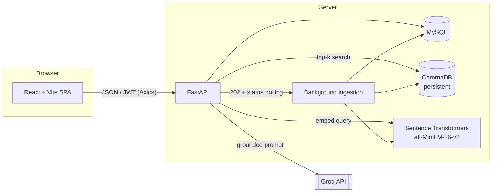
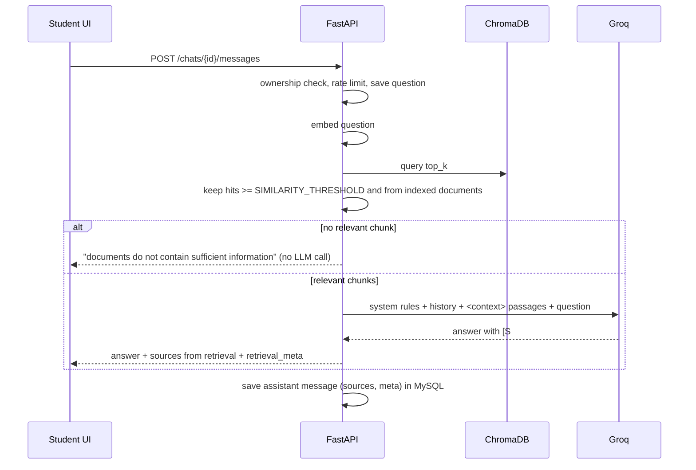
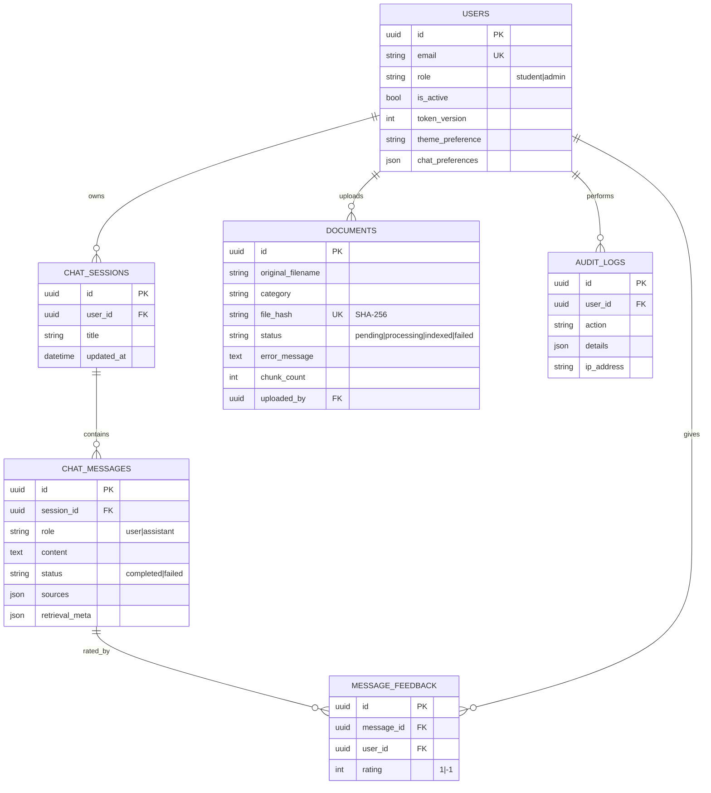

# Architecture

## System overview



MySQL holds relational data (users, chats, messages, document metadata, feedback, audit). ChromaDB holds only vectors plus metadata
(`document_id`, filename, category, pages). `documents.id` in MySQL is the `document_id` stored with every vector, so the two stores stay consistent.

## Ingestion (admin uploads a PDF)

```mermaid
sequenceDiagram
  participant A as Admin UI
  participant S as FastAPI
  participant B as Background task
  participant C as ChromaDB
  A->>S: POST /documents (PDF, category)
  S->>S: validate type, %PDF magic bytes, size; SHA-256 duplicate check
  S->>S: store file under a random name; row status=pending
  S-->>A: 202 Accepted
  S->>B: ingest_document(id)
  B->>B: status=processing; PyMuPDF text per page (NFKC-normalised)
  B->>B: overlapping chunks, each mapped to its page range
  B->>B: MiniLM embeddings (normalised)
  B->>C: add vectors (id = documentId:chunk)
  B->>S: status=indexed, chunk_count (only now)
  A->>S: GET /documents/{id} (polling every 2.5 s)
  Note over B,C: on any error: delete partial vectors, status=failed + readable reason
```

Safety properties: a document is `indexed` only after all vectors are stored; retrieval additionally ignores vectors whose document is not `indexed`;
deleting removes vectors first (if that fails nothing else is deleted); on restart, `pending`/`processing` rows become `failed` so they can be retried.

## Answering a question



Prompt-injection stance: passages are wrapped in a `<context>` block; tag-like text inside them is escaped so a document cannot close the block or fake a role;
the system prompt says the context is untrusted data, forbids following instructions inside it, forbids revealing configuration, and requires citations and
the exact "insufficient information" reply. This reduces risk but no prompt-based defence is absolute.

## Data model



## Frontend structure

- `src/api` - one Axios instance (token header, 401 -> automatic sign-out) and endpoint modules; `errorMessage()` turns any failure into friendly text.
- `src/context` - Auth (session restore, login, logout, password change), Theme (class-based dark mode, synced to the account), Toast, Confirm (promise-based dialog), Chat (history, search, rename/delete).
- `src/pages` - Landing, Login, Register, Chat, KnowledgeBase, Admin (lazy-loaded with Recharts), Settings, NotFound.
- `src/components` - UI primitives (Button, Modal with focus trap, Form fields, badges, skeletons, empty/error states), chat widgets, layout (sidebar, route guards).
- Accessibility: labelled controls, `aria-live` regions for toasts and results, keyboard-operable dialogs and menus, visible focus rings, reduced-motion support, skip link.

## Key design decisions

| Decision | Reason |
|---|---|
| Similarity threshold + "no LLM call" when nothing matches | The cheapest and safest way to stop hallucinated college facts |
| Sources taken from retrieval, not from the model | The user can trust the citation list even if the model misbehaves |
| Failed answers stored as messages with `status=failed` | The UI can offer Retry; the question is never lost |
| Token version in the JWT | Password change / deactivation revoke sessions without a token blacklist |
| `ChromaDB` embeddings supplied explicitly | No hidden model downloads; one embedding model for documents and queries |
| Background task instead of a queue | Simple for a single-server project; restart recovery marks interrupted jobs failed |
