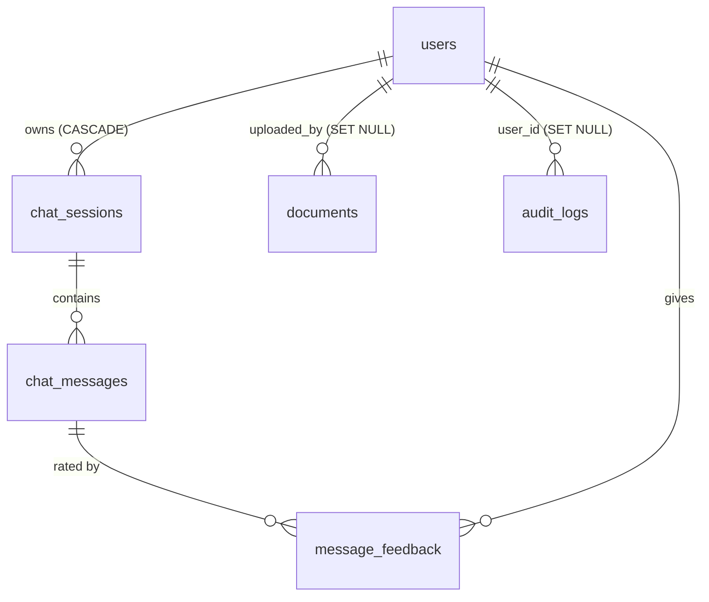

# Database (MySQL 8)

ClgBot stores relational data in **MySQL 8.0** (InnoDB, `utf8mb4`) via SQLAlchemy 2 + PyMySQL, and vectors in ChromaDB.
`documents.id` (MySQL) is the `document_id` stored with every vector in ChromaDB.

## Quick setup

| Way | Commands |
|---|---|
| Installed MySQL | `mysql -u root -p < database/init.sql` then `alembic upgrade head` |
| Docker | `docker compose up -d` (MySQL + Adminer on http://localhost:8080) then `alembic upgrade head` |
| Check | `python -m app.scripts.check_db` (version, charset, time zone, row counts) |

`DATABASE_URL=mysql+pymysql://college_user:<password>@localhost:3306/college_chatbot`
(`mysql://...` is accepted and converted to the PyMySQL driver; `charset=utf8mb4` is added automatically; a PostgreSQL URL is rejected with a clear error.)

## Tables



| Table | Purpose | Notable columns / indexes |
|---|---|---|
| `users` | accounts (student/admin) | unique `email`, `token_version` (revokes JWTs), `chat_preferences` JSON |
| `chat_sessions` | conversations | index `(user_id, updated_at)` for the sidebar |
| `chat_messages` | questions and answers | `content` MEDIUMTEXT, `sources`/`retrieval_meta` JSON, index `(session_id, created_at)` |
| `documents` | uploaded PDF metadata | unique `file_hash` (SHA-256, duplicate detection), `status` pending/processing/indexed/failed |
| `message_feedback` | thumbs up/down | unique `(message_id, user_id)` |
| `audit_logs` | security / admin trail | indexes on `action`, `created_at`, `user_id` |

`database/schema.sql` is the same schema as plain SQL (generated from the migration and import-tested).

## MySQL-specific design decisions

- **UTC everywhere.** Every connection runs `SET time_zone='+00:00'`; `DATETIME(6)` values are stored as UTC and returned as
  timezone-aware datetimes (`UTCDateTime` type in `app/db/types.py`), so the API emits `...Z` timestamps.
- **Microsecond timestamps** (`DATETIME(6)`): a question and its answer are created within the same second and must stay ordered.
- **READ COMMITTED** isolation: each statement sees the latest committed data (MySQL's default REPEATABLE READ gives stale snapshots
  in long sessions and more gap locks).
- **utf8mb4 + utf8mb4_unicode_ci**: emoji and Hindi work; text matching and `email` uniqueness are case-insensitive.
- **MEDIUMTEXT** for message content (plain TEXT stops at 64 KB); **JSON** native columns; UUIDs are stored as `CHAR(32)`.
- **CHECK constraints** need MySQL >= 8.0.16 (older versions silently ignore them). MariaDB 10.5+ also works but is not the tested target.
- `pool_recycle=1800` avoids "MySQL server has gone away" after idle time; `pool_pre_ping` revalidates connections.

## Backup and restore

```powershell
mysqldump -u college_user -p --single-transaction --routines college_chatbot > backup.sql
mysql -u college_user -p college_chatbot < backup.sql
```
Also back up `backend/storage/` (uploaded PDFs and the ChromaDB vector store); the two must be restored together.

## Migrations

`alembic upgrade head` / `alembic downgrade base`; after changing a model run `alembic revision --autogenerate -m "msg"`.
`alembic check` reports "No new upgrade operations detected" when models and database agree (verified).
MySQL DDL is not transactional: if a migration fails half-way, fix the cause and drop the partial tables before retrying.
